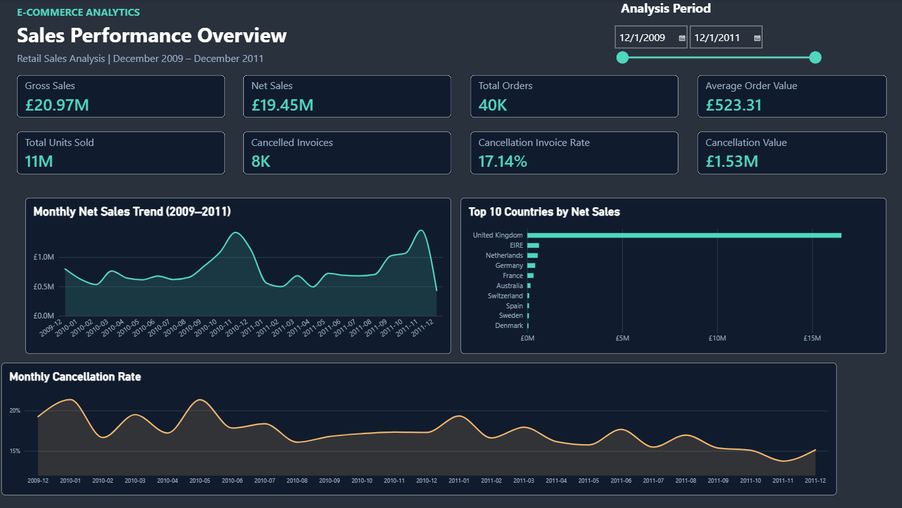
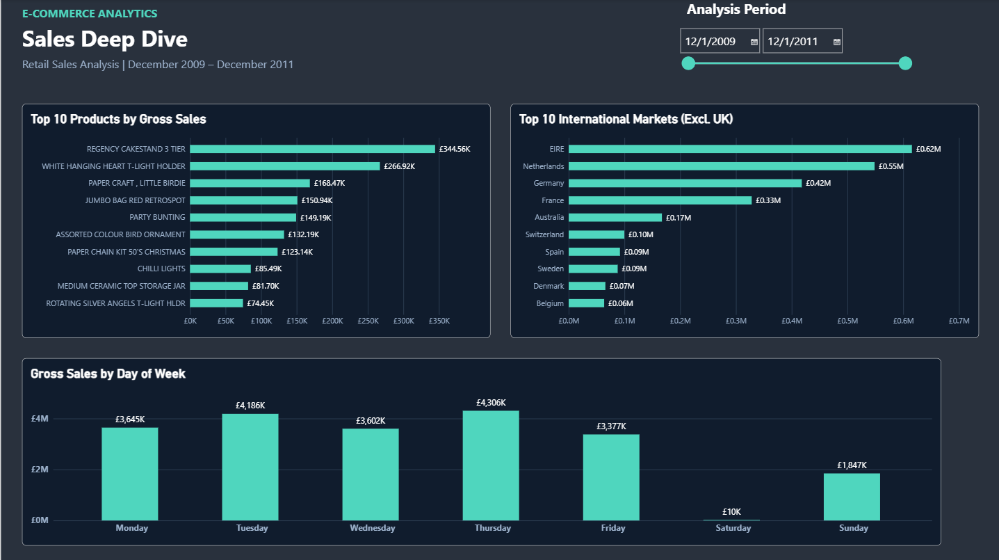

# E-Commerce Sales Performance Analysis

**Power BI | Power Query | DAX | Business Intelligence**

## Overview

I analyzed over **1 million retail transaction records** to understand sales performance, identify cancellation patterns, and compare product and international market performance.

The goal was to build an interactive Power BI dashboard that makes it easier to track key business metrics and investigate unusual transaction activity.

The analysis covers December 2009 to December 2011 using the **Online Retail II** dataset.

## Dashboard

### Executive Overview

Provides an overview of sales performance, including key metrics, monthly net sales, top countries, and cancellation trends.

### Sales Deep Dive

Explores international markets, top products by gross sales, and sales distribution across weekdays.

Both pages include a synchronized date slicer to filter the analysis period.

## Tools Used

- **Power BI:** Interactive dashboards and visualizations
- **Power Query:** Data cleaning, profiling, and transformation
- **DAX:** KPI calculations and analytical measures

## Dataset

**Source:** [UCI Online Retail II Dataset](https://archive.ics.uci.edu/dataset/502/online+retail+ii)

The dataset contains retail transactions from a UK-based online retailer.

| Dataset | Rows |
|---|---:|
| 2009–2010 | 525,461 |
| 2010–2011 | 541,910 |
| **Combined** | **1,067,371** |

Key fields include invoice number, product description, quantity, price, invoice date, customer ID, and country.

## Data Preparation

I used Power Query to prepare the data before building the dashboard.

1. Profiled the data to identify missing values, unusual records, and data type issues.
2. Kept the original imported tables and created separate queries for cleaning.
3. Combined the two annual datasets into one table.
4. Classified transactions into three groups:
   - **Sale:** Positive quantity and price, excluding cancellation invoices.
   - **Cancellation:** Invoice numbers beginning with `C`.
   - **Review:** Other records, including zero-price transactions and negative-price adjustments.
5. Created a Revenue column for valid sales transactions.
6. Added date-related columns for monthly and weekday analysis.

The combined dataset contained **1,041,670 Sale rows**, **19,494 Cancellation rows**, and **6,207 Review rows**.

I retained records with missing customer IDs rather than automatically removing them, since they could still contribute to sales performance.

## Key Metrics

| Metric | Result |
|---|---:|
| Gross Sales | £20.97M |
| Cancellation Value | £1.53M |
| Net Sales | £19.45M |
| Total Orders | ~40K |
| Average Order Value | £523.31 |
| Total Units Sold | ~11M |
| Cancelled Invoices | ~8K |
| Cancellation Invoice Rate | 17.14% |

**Metric definitions:**

- **Gross Sales:** Revenue from valid sale transactions.
- **Cancellation Value:** Value of eligible negative-quantity cancellation lines.
- **Net Sales:** Gross Sales minus Cancellation Value.
- **Total Orders:** Number of distinct sale invoices.
- **Average Order Value:** Gross Sales divided by Total Orders.
- **Cancellation Invoice Rate:** Cancellation invoices divided by the combined number of sale and cancellation invoices.

The cancellation invoice rate does not represent the percentage of original customer orders that were fully canceled.

## Key Findings

### 1. November Recorded Strong Sales

November was one of the strongest months in both years.

- November 2010 Net Sales: **£1.42M**
- November 2011 Net Sales: **£1.46M**
- Year-over-year growth: **2.75%**
- November 2011 sales increased **36.52%** compared with October 2011.

This may reflect seasonal purchasing activity, although the dataset does not confirm the cause.

**Recommendation:** Review product demand during peak months to support inventory and promotional planning.

### 2. International Markets Showed Different Purchasing Patterns

EIRE and the Netherlands were among the strongest markets outside the UK.

| Metric | EIRE | Netherlands |
|---|---:|---:|
| Net Sales | £615,519.55 | £548,524.95 |
| Sale Invoices | 626 | 228 |
| Units Sold | 340,289 | 383,977 |
| Units per Invoice | ~544 | ~1,684 |

The Netherlands recorded more units per invoice, suggesting larger transactions despite having fewer sale invoices.

I also found that **6.44% of EIRE's gross sales** were associated with missing customer IDs, limiting the reliability of customer-level analysis.

**Recommendation:** Investigate differences in product mix and purchasing behavior between markets, while improving customer data completeness.

### 3. Cancellations Had a Significant Financial Impact

Recorded cancellation value totaled approximately **£1.53M**, equivalent to around **7.3% of Gross Sales**.

The Cancellation Invoice Rate was:

- **21.35%** in January 2010
- **13.74%** in November 2011

Although these months differ by **7.61 percentage points**, cancellation rates fluctuated throughout the period.

**Recommendation:** Track both cancellation frequency and value, since a small number of high-value cancellations can materially affect sales results.

### 4. High Gross Sales Did Not Always Mean High Net Sales

One of the most interesting findings involved the product **PAPER CRAFT, LITTLE BIRDIE**.

It recorded:

- **Gross Sales:** £168,469.60
- **Cancellation Value:** £168,469.60
- **Net Sales:** £0

After investigating the underlying transactions, I found a sale of **80,995 units at £2.08 each**, followed by a matching cancellation approximately **12 minutes later** on December 9, 2011.

The product appeared among the top products by Gross Sales but disappeared from the top 10 when ranked by Net Sales.

This showed why looking at gross sales alone can give a misleading impression of product performance.

**Recommendation:** Compare gross and net sales when evaluating products and investigate unusually large transaction reversals.

## Data Quality & Limitations

Several limitations affected how the results should be interpreted:

- **Missing Customer IDs:** Some transactions could not be linked to identified customers.
- **Incomplete December 2011:** Data was available only through December 9, so the final month's decline should not be treated as a full-month performance result.
- **Uneven Saturday Coverage:** Saturday transactions were concentrated in December 2009, limiting weekday comparisons.
- **Review Transactions:** Zero-price records and negative-price adjustments were excluded from operational sales calculations.
- **Cancellation Timing:** Recorded cancellations may relate to earlier sales or partial returns, so calculated Net Sales should not be treated as finalized accounting revenue.
- **Profitability:** Product costs were not available, so actual profit and profit margins could not be calculated.
- **Product Classification:** Selected non-product stock codes were excluded from product rankings; the classification may not cover every possible adjustment code.

## What I Learned

This project helped me practice the full process of building a Power BI analysis, from preparing raw data and defining KPIs to designing dashboards and validating unusual results.

The most valuable part was investigating transactions behind the charts. It showed me how important it is to check metric definitions and data quality before making business recommendations.

## Data Source

[Online Retail II — UCI Machine Learning Repository](https://archive.ics.uci.edu/dataset/502/online+retail+ii)
